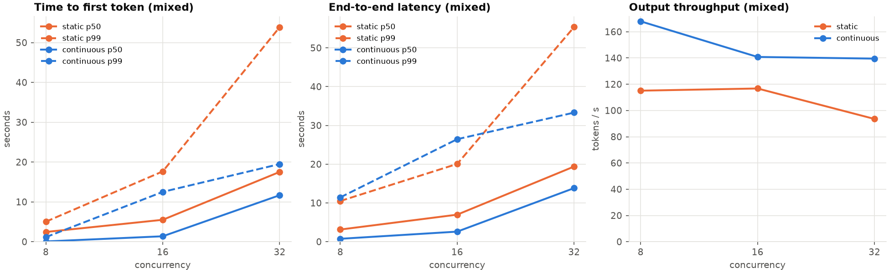
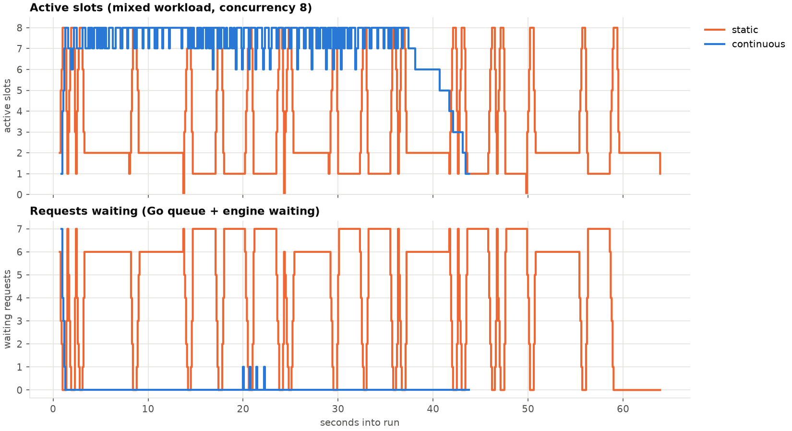
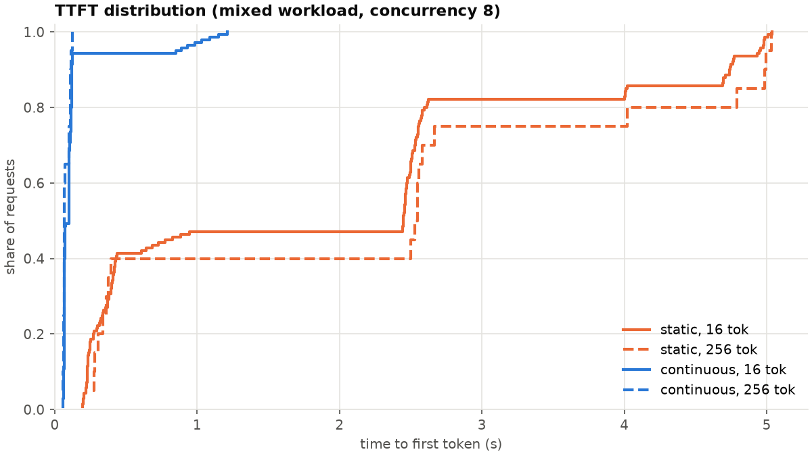
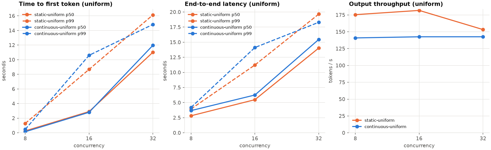
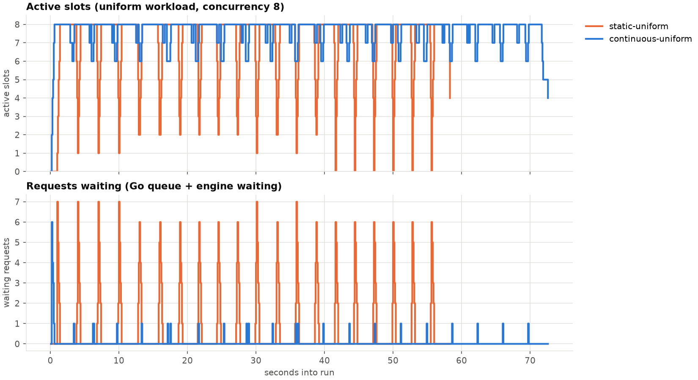
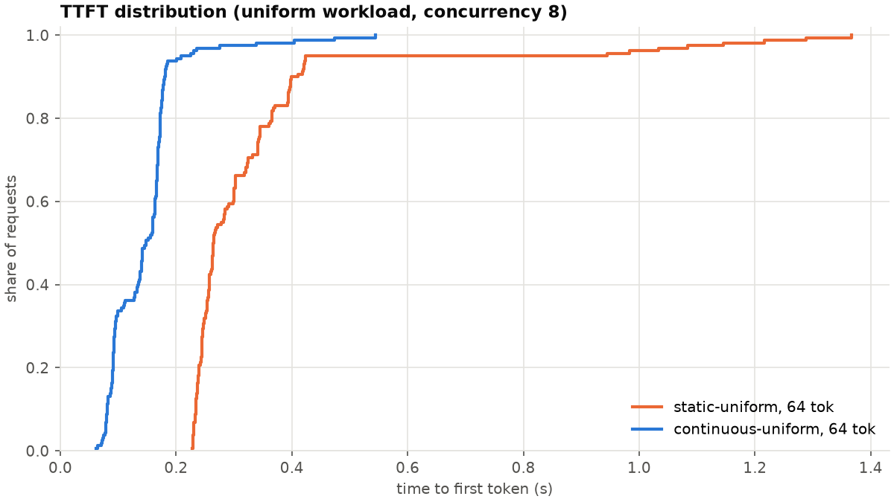

# inference-engine

curl → Go server → Python worker → response

# Inference Serving Infrastructure

A production-grade LLM inference serving system built from scratch in Go, exploring the core systems challenges behind serving large language models at scale: request scheduling, dynamic batching, concurrency control, memory management, and horizontal scaling.

The Go server acts as the control plane — handling HTTP routing, request queuing, batching, and scheduling — while a Python gRPC worker handles model inference via `llama-cpp-python`. This separation mirrors how production systems like vLLM, Triton, and TensorRT-LLM are architected.

## Architecture

```
                  ┌──────────────────────────────────────────────────────────┐
                  │                      Go HTTP Server                      │
                  │                                                          │
  HTTP Request ─► │  Rate limit ─► Validate ─► Priority queue ─► Dispatcher  │
                  │                                                  │       │
                  │             ┌────────────────────────────────────┤       │
                  │             ▼                                    ▼       │
                  │ static:  Batcher ─► Scheduler     continuous: Engine     │
                  │                         │                        │       │
                  └─────────────────────────┼────────────────────────┼───────┘
                       GenerateStream,      │      gRPC (TCP)        │ Engine,
                       one per request      │                        │ one bidi stream
                  ┌─────────────────────────▼────────────────────────▼───────┐
                  │                      Python Worker                       │
                  │                                                          │
                  │  Llama instance behind             engine.py: n slots,   │
                  │  a lock: one request               one llama_decode per  │
                  │  at a time                         step across all slots │
                  └──────────────────────────────────────────────────────────┘
```

The server runs in one of two modes, chosen at startup:

- **Static batching** (default): the Batcher groups requests by size or time, and the Scheduler hands each batch to a worker pool that makes one `GenerateStream` call per request.
- **Continuous batching** (`-continuousBatching`): the Engine keeps a single bidirectional `Engine` stream open to the worker and admits or cancels requests on it. The worker assigns requests to slots and decodes every active slot in one forward pass per step.

## How modern inference engines are benchmarked and profiled

An inference engine is built around a constrained objective: serve as much useful work as possible within latency, memory, cost and output-quality requirements. Interactive chat needs a fast first token and steady generation; an offline job can tolerate waiting to achieve higher throughput. A single tokens-per-second number cannot describe both.

### Prefill and decode have different bottlenecks

**Prefill** processes the prompt and builds its key/value (KV) cache. **Decode** repeatedly uses that cache to generate subsequent tokens. Long prefills often put pressure on compute; small-batch decode often puts pressure on memory bandwidth because each step reads model weights and cached state. The bottleneck changes with model, batch size, context length and hardware. Running a large prefill alongside decoding requests can also delay their next tokens; chunked prefill limits how much prompt work enters one iteration. See [vLLM's prefill/decode tuning guidance](https://docs.vllm.ai/en/stable/configuration/optimization/).

This is why benchmarks separate prompt processing, token generation and complete requests. For example, [llama-bench](https://github.com/ggml-org/llama.cpp/tree/master/tools/llama-bench) measures prompt processing, generation, or both, and can vary context depth, batch size, threads and GPU offload. Its measurements exclude tokenization and sampling, so they are not directly comparable to HTTP serving throughput.

### Metrics: what counts as fast?

For a streaming request, let `t0` be client send time, `t1` the first token's arrival, `tN` the last token's arrival and `N` the output token count:

| Metric | Definition | What it tells us |
| :--- | :--- | :--- |
| Time to first token (TTFT) | `t1 - t0` | Initial wait, including queueing, prefill and transport |
| Inter-token latency (ITL) | Time between successive token arrivals | Whether generation is smooth or stalls |
| Time per output token (TPOT) | `(tN - t1) / (N - 1)`, for `N > 1` | Average generation interval after the first token; hides individual stalls |
| End-to-end latency (E2E) | Full response completion minus `t0` | How long the complete answer takes |
| Output throughput | Total output tokens / elapsed benchmark seconds | Aggregate serving capacity, across all requests |
| Request throughput | Completed requests / elapsed seconds | Capacity for a specified request-length distribution |

Report latency distributions (p50, p95, p99), not just averages. A response chunk can contain several tokens, so chunk timing alone does not reveal every token's arrival time. Always state the measurement boundary and token-counting convention. These distinctions follow [NVIDIA's inference metric definitions](https://docs.nvidia.com/nim/benchmarking/llm/1.0.0/metrics).

Also report rejected requests, timeouts and errors. **SLO goodput** counts successful requests that meet a stated service-level objective, divided by elapsed time. For example, an illustrative chat SLO might require TTFT ≤ 500 ms and TPOT ≤ 50 ms. Throughput that misses that objective is not usable capacity for that application. [vLLM's serving benchmark](https://docs.vllm.ai/en/stable/cli/bench/serve/#--goodput) supports goodput thresholds for TTFT, TPOT and E2E latency. Cost per successful request or per million output tokens should be compared at the same quality and latency target.

### Parameters engines are designed and tuned around

Keep three things separate: the workload being served, the engine settings being changed, and the metrics being optimized.

| Parameter group | Examples | Why it matters |
| :--- | :--- | :--- |
| Model and numerical format | Parameter count, architecture, weight/KV precision, quantization | Set memory demand and kernel work; quality must be checked when precision changes |
| Request shape | Input/output token distributions, context length, shared prefixes, sampling and EOS behavior | Determine prefill cost, decode duration and cache reuse |
| Offered load | Concurrent clients, requests/second, bursts, cancellations | Determine queueing and whether capacity meets demand |
| Scheduling | Maximum active sequences, tokens per iteration, prefill chunk size, admission policy | Balance batching efficiency against first-token and generation latency |
| Memory | KV-cache budget, context limits, prefix caching, eviction/offload | Determine how much live request state fits and when work must wait or be recomputed |
| Execution and placement | CPU threads, accelerator type/count, kernels, tensor/pipeline parallelism, replicas | Determine compute, bandwidth and communication costs |
| Service policy | Queue bounds, deadlines, priorities, rate limits | Determine fairness and behavior when demand exceeds capacity |

Request count and token budget are different limits: eight requests with long prompts need much more prefill work and KV space than eight short requests. Increasing batch width can improve aggregate throughput while making each iteration slower. Reserving more memory for KV state can admit more sequences, but leaves less headroom for weights and execution buffers. Production tuning exposes these trade-offs through controls such as `max_num_seqs`, `max_num_batched_tokens` and `gpu_memory_utilization`; see [vLLM optimization and tuning](https://docs.vllm.ai/en/stable/configuration/optimization/).

### Benchmarking procedure

1. **Fix the comparison.** Record hardware, model/tokenizer revision, quantization, engine/backend versions, thread and device settings, context limits and cache policy. Change one parameter at a time, or explicitly define a configuration sweep.
2. **Exercise representative shapes.** Include short and long prompts, short and long outputs, mixed lengths and the expected prefix reuse. Report actual token counts as well as requested limits. Test output quality separately from serving speed.
3. **Warm up, then measure.** Separate loading, compilation and cache warmup from steady-state measurements; measure cold starts separately if they matter. Repeat trials, alternate configuration order, and report variation. Retain failures and per-request data, not only successful-request percentiles.
4. **Sweep load.** A closed-loop test holds up to `C` requests outstanding; each client waits before sending another. An open-loop test schedules arrivals at a chosen rate independently of completions. Closed-loop traffic backs off automatically as responses slow, so it does not establish behavior under sustained external arrivals. [vLLM's load controls](https://docs.vllm.ai/en/stable/cli/bench/serve/#--request-rate) distinguish request rate, burstiness and maximum concurrency.
5. **Find the operating point.** Plot throughput and tail latency against load. Identify where throughput flattens, queues grow, or the SLO fails. Choose capacity within the target latency/error budget, and report ramp-up and drain effects for short tests.

### Profiling: explain the measured result

A benchmark measures the outcome; a profile locates the time and resource costs behind it. First correlate request latency with queue depth, active sequences, prefill/decode work and KV usage. Then capture a short trace at a representative load, looking for host scheduling delays, expensive model steps, memory transfers or communication stalls.

For CUDA backends, Nsight Systems can show the CPU/GPU execution timeline; PyTorch Profiler can expose operators, shapes and allocations in PyTorch-based engines. Use a profiler appropriate to the actual backend. Detailed tracing adds overhead, so use separate profiling runs and remeasure improvements without it. See [vLLM's profiling guide](https://docs.vllm.ai/en/stable/contributing/profiling/).

High slot occupancy alone does not prove efficient hardware use. An engine can have every slot occupied while waiting on memory or executing slow steps. Interpret occupancy together with step duration, tokens produced, memory use and hardware counters.

## Benchmarks

Our benchmark asks a specific scheduling question: **does refilling slots as requests finish improve throughput and latency when output lengths vary?** It compares continuous and static admission inside the same engine. The intended control is the same hardware, model and seeded workload, changing only the admission policy; the saved results lack the hardware/model manifest needed to independently verify that setup. This is a comparison of our two policies, not a benchmark against vLLM or TensorRT-LLM.

**Headline:** on a mixed-length workload at concurrency 8 (one client per engine slot), continuous batching delivers **1.46× the throughput** and a **34× lower median time to first token**:

| Mixed workload, concurrency 8 | Static | Continuous | Change |
| :--- | ---: | ---: | :--- |
| Output throughput | 115 tok/s | **168 tok/s** | 1.46× |
| Time to first token, p50 | 2,449 ms | **71 ms** | 34× lower |
| Time to first token, p99 | 5,032 ms | **1,149 ms** | 4.4× lower |
| End-to-end latency, p50 | 3,144 ms | **756 ms** | 4.2× lower |
| End-to-end latency, p99 | 10,502 ms | 11,439 ms | 9% higher |
| Engine slot utilization | 35% | **90%** | |

It isn't a free win. Continuous batching makes the **longest** requests slower, and on a workload where every request has the **same length**, static batching has the higher throughput. Both results are below.

### Test setup

- **Hardware and model:** not recorded with these results. Before using the absolute numbers for external comparisons, record the CPU/GPU and memory, exact GGUF model and quantization, llama.cpp/llama-cpp-python versions, backend/offload configuration and thread counts. The example model in Getting Started does not establish which model produced these runs.
- **Engine:** 8 slots, 512-token context per sequence, served through the continuous-batching `Engine` stream (`-continuousBatching`). The policy is selected with the worker's `--engine-policy`:
  - **`continuous`** refills a freed slot on the next decode step.
  - **`static`** forms a batch only after every slot has drained. It waits up to 20 ms (`--engine-static-fill-wait-ms`) for the batch to fill, then seals it until all of its requests finish.
  - Both admit at most one request per step, so the comparison isolates *when* requests may join.
  - This `static` is an engine policy, not the Go server's static mode from Phase 3 (where requests reach the model one at a time).
- **Workloads:** every request generates exactly `max_tokens` tokens (`--bench-ignore-eos`), so request lengths are controlled. Both workloads have an expected mean of 64 output tokens.
  - **Mixed:** 80% of requests ask for 16 tokens, 20% for 256.
  - **Uniform:** every request asks for 64 tokens.
  - The length sequence is seeded (`-seed 1`), so both policies receive the same generated length list at each concurrency. Arrival timing and generated text are not fixed by that seed. All requests use the prompt `"Once upon a time"` at temperature 0.7.
  - The mixed workload's expected mean is 64 tokens, but its realized mean varies: at concurrency 8, the sample contains 140 short and 20 long requests, averaging 46 tokens. Compare policies within the same workload/concurrency pair; mixed and uniform runs do not have equal total output work.
- **Load:** closed loop. *C* clients share a pool of `20 × C` requests, at *C* = 8, 16 and 32 (160, 320 and 640 requests per run). `-requestsPerWorker 20` sets the total; it does not enforce 20 requests for each client. All 4,480 requests returned 200.
- **Metrics:**
  - **TTFT** is measured from HTTP handler receipt until Go receives the first worker token event (`ttft_ms`). The HTTP response is buffered until generation finishes, so this is internal TTFT, not client-observed streaming TTFT. End-to-end latency is measured by the client through reading the full response body.
  - **Throughput** is output tokens divided by wall-clock time.
  - **Slot utilization** is the mean of `active_slots / 8`, sampled from `GET /stats` every 100 ms.

With 8 slots, concurrency 16 and 32 exceed the active-sequence capacity, so much of their latency is queueing (median queue time ≈ median TTFT). This is contention under closed-loop load, not evidence of an unbounded queue under a fixed external arrival rate. Concurrency 8 is the cleanest head-to-head comparison.

### How the general parameters map to this engine

| Concern | Implementation/control | What these runs exercise |
| :--- | :--- | :--- |
| Active sequences | Worker `--engine-slots`, Go `-engineSlots` | Both set to 8; clients sweep 8, 16, 32 |
| Admission policy | `--engine-policy`; static fill wait `--engine-static-fill-wait-ms` | Refill immediately versus seal and drain; 20 ms static fill window |
| Context/KV capacity | `--engine-per-seq-ctx`; `n_ctx = slots × per_seq_ctx` | 512 tokens per sequence, 4,096 total configured context; prompt plus requested output must fit |
| Tokens in a forward pass | `ENGINE_N_BATCH` / `Engine(n_batch=...)`, default 512 | Shared prefill/decode budget; at most one whole prompt admitted per step; no chunked prefill |
| Length distribution | `-maxTokensDist`, `-seed`; worker `--bench-ignore-eos` | Controlled mixed and uniform outputs; one fixed short prompt |
| Backpressure/deadlines | `-maxQueueDepth`, `-queueTimeout`, `-requestTimeout`; client `-timeout` | Raised timeouts let the high-concurrency runs finish; no rejection-policy sweep |

The Go flags `-maxBatchSize`, `-maxBatchWait`, `-workerCount` and `-maxInFlight` belong to the separate static server path. They do not tune this comparison, because both policies use `-continuousBatching` and the worker's `Engine` RPC.

### Reading the measurements correctly

- `runs.csv` contains output tok/s, successful responses/s (`goodput_rps`), E2E p50/p95/p99 and TTFT p50/p99. Here `goodput_rps` means successful HTTP responses per second; there is no latency-SLO filter. Latency percentiles exclude failures, so read them alongside the status/error counts.
- `requests.csv` records request length, status, client latency, queue time, internal TTFT and generated tokens. In engine mode, queue time runs from Go enqueue until Go receives the worker's `Admitted` event, including waits for capacity and worker admission. Break results down by length to expose fairness trade-offs.
- `runs.csv`'s `utilization_pct` is **client activity**: summed successful-request latency divided by `wall time × concurrency`, expressed as a percentage. The headline **engine slot utilization** instead comes from the mean valid `active_slots / 8` samples in `stats.csv`. Neither is GPU utilization.
- `/stats` also exposes `batch_tokens`, `prefill_tokens`, `kv_used` and `step_time_us`, but the current CSV poller does not save them. `step_time_us` times the `llama_decode` call only; it excludes admission, sampling and event delivery. A 100 ms poll of the latest stats also misses individual steps, so a complete step-latency distribution requires recording each worker stats event.

TTFT is currently populated only by the Go `Engine` client. Against the default static server mode, the response's zero-valued `ttft_ms` is uninstrumented, not an instantaneous first token. Both policies in the recorded comparison use the instrumented engine path.

The measurement code is in [bench/loadtest.go](bench/loadtest.go); [bench/analyze.py](bench/analyze.py) generates the plots and length-specific summaries. The Go report uses nearest-rank percentiles, while the analysis script's per-length summaries use pandas' interpolated quantiles, so small numerical differences are expected.

### Mixed workload: where continuous batching wins



Continuous batching has higher throughput at every concurrency (1.46×, 1.21× and 1.49× at 8, 16 and 32). At concurrency 32, it cuts static batching's p99 TTFT from 53.9 s to 19.5 s.



The timeline shows why. Under static batching, a sealed batch stays open until its slowest request finishes. Once the 16-token requests are done, one or two 256-token requests run alone for several seconds while the other slots sit empty and up to seven requests wait outside. This is the convoy effect: static batching averages **35% slot utilization**. Continuous batching refills each slot as it frees up and stays at 7–8 active slots (90%), finishing the same 160 requests in 44 s instead of 64 s.



Static batching's TTFT is a staircase: each step is a batch boundary that a request had to wait out, regardless of its own length. Under continuous batching, 95% of requests see their first token within 150 ms.

**The trade-off: long requests get slower.** Median end-to-end latency by request length, at concurrency 8:

| Policy | 16-token requests | 256-token requests |
| :--- | ---: | ---: |
| Static | 3,126 ms | 5,675 ms |
| Continuous | **740 ms** | 11,240 ms |

Under static batching, a long request spends much of its life decoding in a small batch after the short requests finish. Under continuous batching it usually shares a fuller batch. That is consistent with longer generation time per request even as aggregate throughput increases. The approximate wall time per engine step inferred from elapsed time and step-count progress between valid stats samples is 17 ms for static versus 41 ms for continuous; these are not direct `llama_decode` timings. Continuous batching trades long-request latency for throughput and short-request latency in this run. Priorities or fairness policies are possible ways to manage that trade-off.

### Uniform workload: where static batching holds its own



When every request has the same length, there's no convoy for continuous batching to break up. Static batching has higher throughput at every concurrency: 175 vs. 141 tok/s at 8 (1.24×), 182 vs. 143 at 16, and 153 vs. 143 at 32. Continuous batching still has the lower TTFT at concurrency 8 (p50 148 ms vs. 264 ms, with no batch boundary or fill wait to sit through), but its median end-to-end latency is higher (3,680 ms vs. 2,824 ms).

Both policies keep the engine largely occupied (96% slot utilization for continuous, 89% for static). Elapsed time and step-count progress between valid stats samples suggest about 56 ms of wall time per step for continuous versus 41 ms for static. This points toward a step-cost difference, but the saved samples cannot distinguish model execution from scheduler, sampling or transport overhead.

The four-word prompt makes substantial prefill work an unlikely explanation, but the cause remains an open question. One hypothesis is KV-cache layout: static admission lets all sequences drain before a new batch forms, while continuous admission keeps sequences with different lifetimes resident. Whether this changes the backend's attention work needs a trace. Record `step_time_us`, batch/prefill token counts and KV usage per step, then compare decode-only steps at similar batch widths and context lengths before attributing the gap to the cache.

<details>
<summary>Uniform workload: timeline and TTFT distribution</summary>





</details>

### All runs

| Workload | Concurrency | Policy | Throughput (tok/s) | TTFT p50 | TTFT p99 | E2E p50 | E2E p99 |
| :--- | ---: | :--- | ---: | ---: | ---: | ---: | ---: |
| Mixed | 8 | Static | 115 | 2.4 s | 5.0 s | 3.1 s | **10.5 s** |
| Mixed | 8 | Continuous | **168** | **0.07 s** | **1.1 s** | **0.8 s** | 11.4 s |
| Mixed | 16 | Static | 117 | 5.5 s | 17.7 s | 7.0 s | **20.1 s** |
| Mixed | 16 | Continuous | **141** | **1.4 s** | **12.5 s** | **2.6 s** | 26.5 s |
| Mixed | 32 | Static | 94 | 17.5 s | 53.9 s | 19.4 s | 55.4 s |
| Mixed | 32 | Continuous | **140** | **11.7 s** | **19.5 s** | **13.8 s** | **33.3 s** |
| Uniform | 8 | Static | **175** | 0.26 s | 1.3 s | **2.8 s** | **4.0 s** |
| Uniform | 8 | Continuous | 141 | **0.15 s** | **0.5 s** | 3.7 s | 4.2 s |
| Uniform | 16 | Static | **182** | 2.9 s | **8.7 s** | **5.5 s** | **11.2 s** |
| Uniform | 16 | Continuous | 143 | **2.8 s** | 10.6 s | 6.3 s | 14.1 s |
| Uniform | 32 | Static | **153** | **11.0 s** | 16.1 s | **14.0 s** | 19.6 s |
| Uniform | 32 | Continuous | 143 | 12.0 s | **14.8 s** | 15.5 s | **18.3 s** |

Bold marks the better policy in each pair. Raw data is in `bench/results/`: `runs.csv` (one row per run), `requests.csv` (one row per request) and `stats.csv` (`/stats` samples).

### Reproducing

Use the same model, backend and machine for each policy. Warm up each configuration before measured runs, and keep warmup output separate. The commands below reproduce the workload and configuration; the missing original environment metadata prevents an exact reproduction of the historical timings.

```bash
# 1. Worker: pick the policy. --bench-ignore-eos makes every request generate exactly max_tokens.
cmd/worker/venv/bin/python cmd/worker/worker.py --model-path "$MODEL_PATH" \
  --engine-slots 8 --engine-policy continuous --bench-ignore-eos

# 2. Server: continuous-batching mode. Raise the timeouts, or requests queued at
#    concurrency 16 and 32 hit the 5 s default queue timeout and return 504.
go run ./cmd/server -continuousBatching -engineSlots 8 -queueTimeout 300s -requestTimeout 300s

# 3. Load: the Makefile defaults are the mixed workload (16:0.8,256:0.2) at concurrency 8, 16 and 32,
#    20 requests per client.
make bench LABEL=continuous
make bench LABEL=continuous-uniform BENCH_MIX=64:1

# 4. Restart the worker with --engine-policy static, then:
make bench LABEL=static
make bench LABEL=static-uniform BENCH_MIX=64:1

# 5. Summary tables and graphs (needs pandas and matplotlib from requirements.txt)
cmd/worker/venv/bin/python bench/analyze.py
```

The load tester appends to the CSVs. Archive the existing CSVs before a fresh set of runs, or select separate files with `-out`, `-reqOut` and `-statsOut`. `analyze.py` reads `bench/results/`, pairs runs by these four labels and assumes 8 slots; adjust those settings when changing the experiment. Reusing labels for repeated trials without separating the files will merge their samples in the analysis.

The load tester also works on its own, against either server mode:

```bash
# One level: 50 concurrent clients, 1000 requests
go run ./bench -concurrency 50 -totalRequest 1000

# Sweep concurrency levels with a length mix, 20 requests per client at each level
go run ./bench -sweep 1,10,50,100,500 -requestsPerWorker 20 -maxTokensDist 16:0.8,256:0.2 -label mytest
```

For each concurrency level it reports p50/p95/p99 latency, TTFT, goodput, and counts of 429s, timeouts and 5xx errors. It appends one summary row to `bench/results/runs.csv` and one row per request to `bench/results/requests.csv`. It also polls `GET /stats` every `-statsInterval` (default 100 ms) into `bench/results/stats.csv`, which records queue depth and engine occupancy over time.

### What these benchmarks establish, and what remains

These runs demonstrate the scheduling trade-off for a short-prompt workload: continuous admission recovers empty slots when output lengths differ, improving aggregate throughput and short-request latency. They also show why throughput, TTFT and E2E latency must be reported together: long requests can slow down, and the uniform workload favors static admission.

There is one recorded trial per configuration, with no confidence intervals or recorded warmup procedure. Each p99 at concurrency 8 is determined by only a few requests. The suite does not yet measure client streaming ITL/TPOT, SLO goodput, accelerator utilization, memory bandwidth, cost, output quality, long-prompt behavior or multi-device scaling. `--bench-ignore-eos` deliberately controls work instead of reproducing natural completion lengths.

The next useful experiments are repeated trials with an environment manifest; prompt-length and slot-count sweeps; fixed-rate/bursty arrivals with rejection and deadline accounting; and per-step traces for the uniform-workload gap. Add streaming token timestamps to measure user-visible TTFT and ITL. These would turn the current admission-policy comparison into a broader capacity and latency characterization.

## Project Structure

```
inference-engine/
├── cmd/
│   ├── server/
│   │   └── main.go                 # Server entry point; wires static or continuous mode
│   └── worker/
│       ├── worker.py               # Python gRPC worker (Generate, GenerateStream, Engine RPCs)
│       ├── engine.py               # Continuous batching engine: slot scheduler over one llama_context
│       ├── drive.py                # Drives engine.py directly, without gRPC
│       ├── inference_pb2*.py(i)    # Generated protobuf code (Python)
│       └── tests/                  # pytest: engine tests and worker gRPC tests
├── internal/
│   ├── api/
│   │   ├── server.go               # Route registration
│   │   ├── handler.go              # HTTP handlers: /v1/completions, /healthz, /stats
│   │   └── ratelimiter.go          # Per-client token bucket rate limiter
│   ├── config/
│   │   └── config.go               # Command-line flags
│   ├── types/
│   │   └── types.go                # Request/response types and validation
│   ├── queue/
│   │   └── queue.go                # Priority queue with aging
│   ├── dispatcher/
│   │   └── dispatcher.go           # Pops the queue, enforces the queue timeout
│   ├── batcher/
│   │   └── batcher.go              # Dynamic batch accumulator (static mode)
│   ├── scheduler/
│   │   └── scheduler.go            # Static-mode worker pool and continuous-mode Engine client
│   └── worker/
│       └── client.go               # gRPC client constructor
├── proto/
│   └── inference.proto             # gRPC service definition
├── gen/                            # Generated protobuf code (Go)
├── bench/
│   ├── loadtest.go, helpers.go     # Load tester (go run ./bench)
│   ├── analyze.py                  # Summary tables and graphs
│   └── results/                    # Benchmark CSVs and graphs
├── test/
│   └── e2e/
│       └── e2e_test.go             # End-to-end tests against a real server and worker
├── transformer/                    # Separate track: a GPT model and distributed training in PyTorch
├── go.mod
├── go.sum
├── Makefile
├── requirements.txt                # Python dependencies
├── MULTIMODAL.md                   # Notes on extending toward multimodal/voice serving
└── README.md
```

## Getting Started

### Prerequisites

- Go 1.26+ (see `go.mod`)
- Python 3.10+
- A GGUF model file (e.g., TinyLlama 1.1B Chat Q4_K_M)
- To regenerate protobuf code only: `protoc` with `protoc-gen-go` and `protoc-gen-go-grpc`. The generated code is committed (`gen/` and `cmd/worker/inference_pb2*`), so you don't need these to run the project.

### Setup

```bash
# Clone the repo
git clone https://github.com/yashp5/inference-engine.git
cd inference-engine

# Python environment. The Makefile test targets and the e2e test expect it at cmd/worker/venv.
# (requirements.txt also installs torch and wandb for transformer/, and pandas and matplotlib
# for bench/analyze.py; the worker itself
# needs grpcio, grpcio-tools, grpcio-reflection, protobuf and llama-cpp-python.)
python3 -m venv cmd/worker/venv
cmd/worker/venv/bin/pip install -r requirements.txt

# Download a model (example)
mkdir -p models/
# Place your .gguf file in models/, then point MODEL_PATH at it.
# The worker's --model-path overrides this, but the tests read MODEL_PATH only.
export MODEL_PATH=$PWD/models/tinyllama-1.1b-chat-v1.0.Q4_K_M.gguf

# Start the Python worker
cmd/worker/venv/bin/python cmd/worker/worker.py --model-path "$MODEL_PATH" --port 50051

# Start the Go server (in a separate terminal)
go run ./cmd/server -workerAddr 127.0.0.1:50051

# Test
curl -X POST http://localhost:8080/v1/completions \
  -H "Content-Type: application/json" \
  -d '{"prompt": "Once upon a time", "max_tokens": 50, "temperature": 0.7}'
```

To use continuous batching instead of the default static batching, start both sides with the same slot count:

```bash
cmd/worker/venv/bin/python cmd/worker/worker.py --model-path "$MODEL_PATH" --engine-slots 8
go run ./cmd/server -continuousBatching -engineSlots 8
```

To regenerate protobuf code after editing `proto/inference.proto`:

```bash
make generate PYTHON=cmd/worker/venv/bin/python
```

### Tests

```bash
make test-engine   # engine.py, in process (pytest)
make test-worker   # starts worker.py and exercises its gRPC API (pytest)
make test-e2e      # builds the server with -race, starts a real worker, tests continuous batching end to end
make test          # all three
```

All three need a model at `MODEL_PATH`. The Python tests skip when it's missing; the e2e test fails. The e2e test runs the worker with `cmd/worker/venv/bin/python` unless `WORKER_PYTHON` is set.

### Configuration

Go server flags (`go run ./cmd/server -h`):

| Flag | Default | Purpose |
| :--- | :--- | :--- |
| `-httpAddr` | `127.0.0.1:8080` | HTTP listen address |
| `-workerAddr` | `127.0.0.1:50051` | Worker gRPC address |
| `-continuousBatching` | `false` | Use the `Engine` bidi stream instead of static batching |
| `-engineSlots` | `8` | Continuous mode: slot count; must match the worker's `--engine-slots` |
| `-maxBatchSize` | `8` | Static mode: max requests per batch (`1` disables batching) |
| `-maxBatchWait` | `10ms` | Static mode: max wait after the first request enters a batch |
| `-workerCount` | `4` | Static mode: scheduler worker goroutines |
| `-maxInFlight` | `10` | Static mode: cap on concurrent calls to the worker |
| `-maxQueueDepth` | `1000` | Queue capacity; 429 beyond it |
| `-queueTimeout` | `5s` | Max wait for admission; 504 beyond it |
| `-requestTimeout` | `60s` | Deadline for the whole request, generation included |
| `-agingInterval` | `5s` | Queue wait that raises a request one priority level |
| `-rateLimit` | `false` | Enable per-client rate limiting |
| `-rateLimitN`, `-rateLimitWindow` | `100`, `1s` | Token bucket: N requests per window |
| `-rateLimitBucketTTL` | `5m` | Drop a client's bucket after this long idle |
| `-rateLimitSweepInterval` | `1m` | How often idle buckets are swept |

Python worker flags (`cmd/worker/worker.py`):

| Flag | Default | Purpose |
| :--- | :--- | :--- |
| `--model-path` | `$MODEL_PATH` | GGUF model to load |
| `--port` | `50051` (`$WORKER_PORT`) | gRPC port |
| `--engine-slots` | `8` | Continuous batching slots (KV sequences) |
| `--engine-per-seq-ctx` | `512` | Context per sequence; engine `n_ctx` = slots × this |
| `--llm-n-ctx` | `512` | Context for the `Llama` instance used in static mode |
| `--max-threads` | `4` (`$WORKER_MAX_THREADS`) | gRPC thread pool; must exceed the number of concurrent long-lived streams |
| `--engine-policy` | `continuous` | Engine admission policy: `continuous`, or `static` (benchmark baseline) |
| `--engine-static-fill-wait-ms` | `20` | Static policy: how long a new batch waits to fill before it's sealed |
| `--bench-ignore-eos` | off | Benchmarks only: always generate exactly `max_tokens` |

## Build Phases

The project is built incrementally. Each phase adds a layer of complexity that addresses a real production concern.

| Phase | Status |
| :--- | :--- |
| 1. Single model, single request server | Done |
| 2. Request queue and concurrency control | Done |
| 3. Dynamic batching | Done (batches form in Go; see the note in Phase 3) |
| 4. Continuous batching | Done |
| 5. Multi-model management and memory | Not started |
| 6. Observability and metrics | Partial: `/healthz` and `/stats` |
| 7. Horizontal scaling and load balancing | Not started |
| 8. KV cache management | Not started |

Phase 4's results are in [Benchmarks](#benchmarks). The benchmarks planned for the other phases haven't been run yet.

### Phase 1 — Single Model, Single Request Server

The foundation: a Go HTTP server that proxies inference requests to a Python gRPC worker.

**What's built:**
- gRPC service definition (`proto/inference.proto`) with `GenerateRequest`/`GenerateResponse`
- Python worker that loads a GGUF model via `llama-cpp-python` and serves inference over gRPC
- Go HTTP server with `POST /v1/completions` endpoint
- Input validation (non-empty prompt, max_tokens bounds, temperature range)
- Per-request latency tracking: queue time, inference time, total time
- Request ID generation (UUIDv7) in the Go server

**Key design decisions:**
- Go handles the control plane (HTTP, routing, scheduling); Python handles the data plane (GPU/CPU inference). This separation is how production serving systems work.
- gRPC over TCP between Go and Python for clean serialization and future streaming support.
- Single gRPC connection created at server startup, not per request.

**Concepts:** HTTP server design, gRPC client/server, protobuf serialization, latency measurement

---

### Phase 2 — Request Queue and Concurrency Control

The model can only handle a limited number of concurrent requests. This phase adds admission control, queuing, and fairness.

**What's built:**
- In-memory priority queue using `container/heap` to buffer incoming requests (`internal/queue`)
- Concurrency limit on calls to the worker: a semaphore (buffered channel, `-maxInFlight`) in static mode, and the engine's slot count (`-engineSlots`) in continuous mode
- Dispatcher goroutine that pops the highest-priority request and hands it to the batcher or the engine
- HTTP 429 (Too Many Requests) with `Retry-After` header when the queue is full (`-maxQueueDepth`)
- Per-client rate limiting with token buckets, keyed by the `X-API-Key` header or else the client IP. The buckets live in a mutex-guarded map, and a sweeper drops idle ones. Off by default (`-rateLimit`)
- Priority levels (`low`/`medium`/`high`, default `medium`) with aging for starvation prevention: every `-agingInterval` spent waiting raises a request one level, capped so a starved `low` can tie a fresh `high` but never outrank it
- `context.Context` propagation throughout. Requests whose client has already gone are dropped at dispatch. A disconnect mid-generation cancels the worker call in static mode, and sends a `Cancel` that frees the slot in continuous mode
- Configurable queue timeout: requests waiting longer than `-queueTimeout` return HTTP 504. `-requestTimeout` separately bounds the whole request, generation included
- Queue wait and inference time reported separately (`queue_time_ms`, `inference_time_ms`)

**Benchmarking plan:**
- Hit the server with increasing concurrency (1, 10, 50, 100, 500 concurrent requests)
- Measure p50, p95, p99 latency, throughput (req/s), queue depth over time, rejection rate
- Plot how these degrade as load increases

**Concepts:** Priority queues, semaphores, goroutine coordination, rate limiting, backpressure, context cancellation

---

### Phase 3 — Dynamic Batching

The single most impactful optimization in inference serving. Instead of processing one request at a time, accumulate multiple requests and process them as a batch.

**What's built:**
- Batch accumulator goroutine (`internal/batcher`) that collects requests using two triggers:
  - Batch reaches max size (`-maxBatchSize`, default 8), OR
  - Max wait time expires (`-maxBatchWait`, default 10ms since the first request entered the batch)
- `select` statement with a `time.Timer` for the timeout trigger
- Fan-out logic: each request in the batch has a response channel, so each result routes straight back to its waiting HTTP handler
- Accumulator slice preallocated to the max batch size
- Configurable batch size and max wait time as command-line flags

**Note:** batches form on the Go side only. The scheduler sends each request in a batch as its own `GenerateStream` call, and the worker serializes those calls on a single lock-guarded `Llama` instance. In this mode the model still runs one request at a time. Batched forward passes arrive with continuous batching in Phase 4.

**Benchmarking plan:**
- Compare throughput and latency against Phase 2 (no batching)
- Under high load: batching should dramatically increase throughput
- Under low load: should add minimal latency (just the max wait time at worst)
- Show both regimes in plots, document the tradeoff

**Key tradeoff:** Larger batches improve throughput but increase latency for early-arriving requests. Smaller max wait times reduce latency but send partially-full batches.

**Concepts:** Dynamic batching, fan-out/fan-in, channel-based coordination, throughput vs. latency tradeoffs

---

### Phase 4 — Continuous Batching

What makes systems like vLLM special. Standard batching waits for all requests in a batch to finish before starting the next batch. Continuous batching lets new requests join at every decode step.

**What's built:**
- Bidirectional streaming RPC, `Engine(stream EngineRequest) returns (stream EngineEvent)`. Go sends `Admit` and `Cancel`; the worker answers with `Admitted`, `Token`, `Finished`, `Rejected`, and a `StepStats` event every step
- Slot-based scheduler in the worker (`cmd/worker/engine.py`): `n_slots` KV sequences share one `llama_context` (`n_ctx = slots × per_seq_ctx`), driven directly through the llama.cpp C API
- Each step is one `llama_decode` over the next token of every active slot, plus the prefill of at most one newly admitted request, so a long prompt can't stall the other requests' inter-token latency
- Slots freed by EOS, `max_tokens` or a cancel are refilled from the waiting queue on the next step. The batch stays as full as possible at all times
- Admission guards: a prompt plus `max_tokens` that can't fit one sequence's context is rejected, and a prefill that doesn't fit the current batch waits. If the KV cache runs out of room, the new admission is rolled back; with no admission to roll back, the sequence using the most context is evicted with an error
- Go client (`scheduler.Engine`): a slot semaphore sized to `-engineSlots`, a single sender goroutine that sends cancels before admits (gRPC `Send` isn't safe for concurrent use), and reconnects with exponential backoff. When the stream drops, every in-flight request is failed so no slot leaks
- The latest `StepStats` are served at `GET /stats`, and responses report time to first token (`ttft_ms`)
- A static admission policy in the same engine (`--engine-policy static`) as a controlled baseline for benchmarks
- Enabled with `-continuousBatching`; `-engineSlots` must match the worker's `--engine-slots`
- Tests: engine tests, worker gRPC tests, and a Go e2e suite covering concurrency above the slot count, client disconnects, rejections, and a worker crash with reconnect

**Why it matters:** In LLM inference, different requests generate different numbers of tokens. With static batching, a request wanting 10 tokens holds its slot until the request wanting 500 tokens finishes. Continuous batching recovers those wasted cycles.

**Results:** on mixed-length requests, 1.46× the throughput and a 34× lower median TTFT than static batching, at the cost of slower long requests. On uniform lengths, static batching keeps higher throughput. See [Benchmarks](#benchmarks).

**Concepts:** Iteration-level scheduling, streaming RPC, slot management, GPU utilization optimization

---

### Phase 5 — Multi-Model Management and Memory

A real serving system runs multiple models and manages limited memory.

**What to build:**
- Model registry: knows available models (name, size, path on disk)
- Endpoints to load and unload models (`POST /v1/models/load`, `DELETE /v1/models/{name}`)
- Memory tracking: refuse to load a model if it would exceed the memory limit
- LRU eviction: when a request arrives for an unloaded model and there's no memory, evict the least-recently-used model
- Cold-start latency tracking (model loading time) as a separate metric
- Warm-up and preloading: on startup, preload the most commonly requested models
- Model isolation: each model gets its own worker process; Go server routes requests based on the `model` field in the request
- `map[string]*Worker` with proper mutex protection

**Concepts:** Resource management, LRU caches, process lifecycle management, mutex patterns

---

### Phase 6 — Observability and Metrics

No production system exists without observability.

**Status:** partial. `GET /healthz` reports the worker connection state, and `GET /stats` serves queue depth, in-flight requests and the latest engine step stats as JSON. The rest of this phase is still to build.

**What to build:**
- `/metrics` endpoint in Prometheus format using `prometheus/client_golang`:
  - Request count (total, by model, by status code)
  - Latency histograms (queue time, inference time, total time)
  - Batch sizes (histogram)
  - Queue depth (gauge)
  - Active in-flight requests (gauge)
  - Model load/unload events (counter)
  - Error rates (counter by error type)
- Structured logging with `slog` (Go's standard structured logger):
  - Every request logged with: request ID, timestamps at each stage (received, queued, dispatched, completed), model name, token counts, latency breakdown
  - JSON-formatted output
- Health check endpoints:
  - `GET /healthz` — is the server up?
  - `GET /readyz` — is at least one model loaded and ready?
  - `GET /livez` — are workers responsive?
- Dashboard: either a Grafana JSON config or a Go-served HTML page with Chart.js polling a `/stats` endpoint

**Concepts:** Prometheus metrics, structured logging, health check patterns (Kubernetes-style), observability best practices

---

### Phase 7 — Horizontal Scaling and Load Balancing

This is where it becomes a distributed systems project.

**What to build:**
- Multiple server instances: run 2-4 instances, each managing its own workers
- Go load balancer that sits in front and routes requests with smart routing:
  - Model affinity: prefer sending a request to a server that already has the model warm
  - Least-loaded: fall back to the server with the shortest queue if the preferred one is overloaded
  - Consistent hashing: map model names to server instances; when a server goes down, only its models need redistribution
- Service discovery: each server instance registers with the load balancer on startup and sends periodic heartbeats; missed heartbeats → stop routing to that instance
- Fault tolerance: demonstrate that removing a server only disrupts a fraction of requests

**Benchmarking:**
- Compare throughput of 1 vs 2 vs 4 server instances
- Measure cache hit rate (requests served by a server with the model already loaded)
- Show fault tolerance: kill a server, measure impact on in-flight requests

**Concepts:** Load balancing strategies, consistent hashing, service discovery, heartbeats, fault tolerance, distributed systems

---

### Phase 8 — KV Cache Management

Advanced but extremely relevant to current LLM infrastructure.

**What to build:**
- Cache layer in Go that maps prompt prefixes (hashed) to cached KV state
- On new request, check if any prefix of the prompt has a cached KV state
- If cache hit, tell the worker to resume from cached state instead of recomputing the full prefillA
- LRU eviction for the cache (KV states are large)
- Cache hit/miss rate metrics

**Why it matters:** If a user sends a follow-up message with the same system prompt prefix, reusing the KV cache avoids recomputing the entire prefill — a major latency win in production chat systems.

**Concepts:** Prefix caching, hash-based lookup, memory management, prefill optimization

---

## API

### POST /v1/completions

```json
// Request
{
  "prompt": "Once upon a time",
  "max_tokens": 100,
  "temperature": 0.7,
  "priority": "high"
}

// Response
{
  "request_id": "0199a3f2-6c1e-7b4a-9d2e-5f8c1a7b3e90",
  "generated_text": "in a land far away...",
  "tokens_generated": 42,
  "inference_time_ms": 850,
  "queue_time_ms": 12,
  "total_time_ms": 870,
  "ttft_ms": 95
}
```

Validation: `prompt` must be non-empty, `max_tokens` between 1 and 4096, `temperature` between 0.0 and 2.0, and `priority` one of `low`, `medium` (the default) or `high`. When rate limiting is on, clients are identified by the `X-API-Key` header, or by IP without it.

Errors return `{"request_id": "...", "error": "..."}`:

| Status | When |
| :--- | :--- |
| 400 | Unreadable body or failed validation |
| 429 | Rate limited, or queue full (with `Retry-After: 1`) |
| 504 | Waited longer than `-queueTimeout` for admission, or exceeded `-requestTimeout` |
| 500 | Worker error, or generation ended early (cancelled or evicted) |

### GET /healthz
Returns 200 `{"status": "ok"}` when the gRPC connection to the worker is ready, and 503 with `worker_not_ready` or `worker_unavailable` otherwise.

### GET /stats

```json
{
  "queue_depth": 3,
  "in_flight": 11,
  "engine": {
    "step": 1842,
    "active_slots": 8,
    "free_slots": 0,
    "waiting": 0,
    "batch_tokens": 8,
    "prefill_tokens": 0,
    "step_time_us": 41250,
    "kv_used": 1630,
    "observed_at": "2026-09-26T12:00:00Z"
  }
}
```

`in_flight` counts requests past the rate limiter that haven't been answered, queued ones included. `engine` is the worker's latest step stats; it appears only in continuous mode while an engine stream is live.

## How This Compares to Production Systems

This project builds the same *shape* as production inference stacks at roughly
1/1000th the scale. The concepts transfer directly; the divergence is depth per
layer, not different layers.

### Where it maps almost 1:1

- **Control plane / data plane split** — vLLM, TensorRT-LLM/Triton, and SGLang all
  separate orchestration (HTTP, queuing, scheduling, routing) from model execution.
  The Go-server/Python-worker split here is that pattern in miniature; vLLM even
  mirrors the language split (Python orchestration around a C++/CUDA core, with a
  Go/Rust router in front).
- **Continuous batching (Phase 4)** — iteration-level scheduling with slot swap-in
  is literally what vLLM's engine step does. This is the core scheduling loop of a
  modern inference engine, not an analogy to it.
- **Prefix/KV caching (Phase 8)** — production-critical everywhere. Anthropic and
  OpenAI expose it as a billed product feature (prompt caching); SGLang's
  RadixAttention is a more sophisticated version of hash-based prefix lookup.
- **Backpressure and admission control (Phase 2)** — 429s with `Retry-After`,
  priority queues, and per-user token buckets are exactly how API gateways in front
  of model fleets behave under load.
- **Session affinity and drain-aware deploys** (see [MULTIMODAL.md](MULTIMODAL.md))
  — realtime voice APIs live with the same constraint: stream state pins to a
  worker, and re-routing mid-session is forbidden.
- **Disaggregated serving** — per-stage independent scaling is the same principle
  as prefill/decode disaggregation (DistServe, Mooncake), one of the most active
  production serving topics today.

### Where production diverges

- **Inside the model step** — PagedAttention, custom CUDA kernels, CUDA graphs,
  quantization, speculative decoding, chunked prefill. This project deliberately
  treats the intra-GPU layer as a black box (delegated to llama.cpp); production
  teams spend enormous effort there, but it's a different discipline — kernels,
  not systems.
- **KV cache as a distributed object** — at scale, KV state migrates between
  machines (RDMA transfer, tiered CPU/disk offload, cache-aware routing that
  chases prefixes across the fleet). Phase 8 here is single-node; production makes
  it a distributed storage problem.
- **Multi-tenancy economics** — quotas, fair-share across thousands of customers,
  priority tiers tied to billing, abuse handling. The token buckets in Phase 2 are
  the seed of this, but the real version is a large system of its own.
- **Fleet operations** — Kubernetes, weight distribution to thousands of nodes,
  heterogeneous GPU generations, and failure rates where something is always
  broken. Phase 7's heartbeats are the toy version of a much hairier reliability
  problem.
- **The scheduler itself as a hot path** — at high QPS the router/scheduler becomes
  performance-critical code (Rust/C++, lock-free structures), not straightforward
  Go.

## Reading List

Papers and resources that inform the design of this system:

- **Efficient Memory Management for Large Language Model Serving with PagedAttention** (Kwon et al., 2023) — The foundational vLLM paper. Explains why KV cache memory management matters and how virtual memory concepts apply to inference serving.
- **How Continuous Batching Enables 23x Throughput in LLM Inference** (Anyscale blog) — Explains static vs. dynamic vs. continuous batching with benchmarks. Motivation for Phases 3 and 4.
- **Inside vLLM: Anatomy of a High-Throughput LLM Inference System** (vLLM blog, 2025) — Walks through vLLM's scheduler, engine core, and prefill/decode handling. Reference architecture for Phase 4.
- **Go Concurrency Patterns** and **Advanced Go Concurrency Patterns** (Go blog) — The select-with-timeout, fan-out/fan-in, and pipeline patterns used throughout the batching and scheduling logic.
- **Designing Data-Intensive Applications** (Kleppmann) — Chapters on replication, partitioning, and distributed systems apply directly to Phase 7.

## License

MIT
